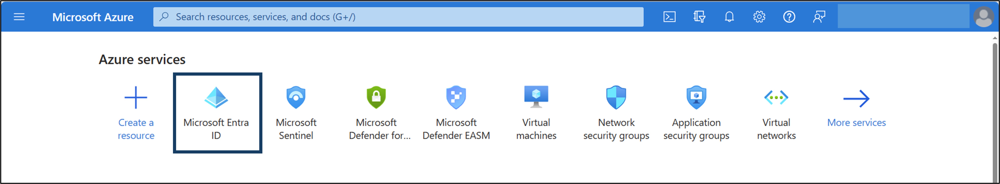
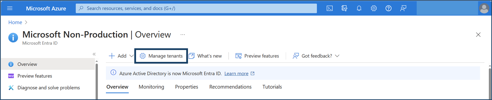
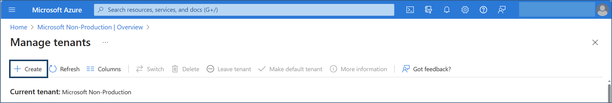
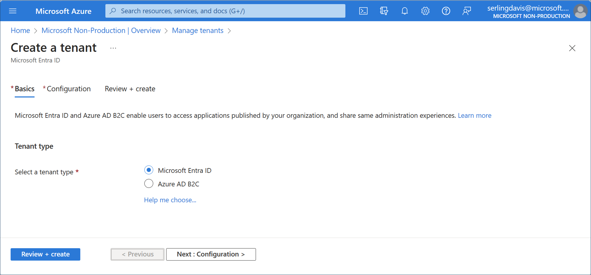
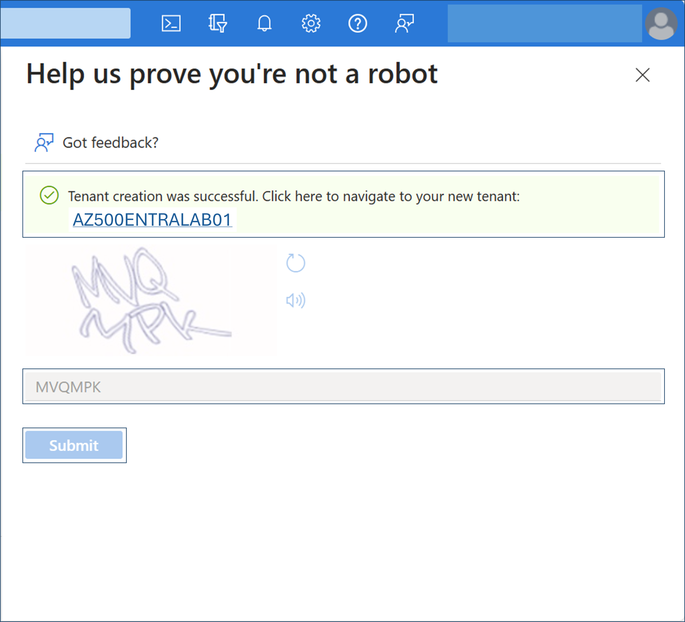

---
lab:
    title: '01 - Create a tenant'
    module: 'Module 00 - Create a new tenant in Microsoft Entra ID'
---

The main goal of this exercise is to provide hands-on experience in Create a new tenant for your organization. 

---

## Skilling tasks

- Use the Microsoft Entra admin center to create a new tenant for your organization

## Exercise instructions

### Create a new tenant

1. Sign-in to the [Azure portal menu.](https://portal.azure.com/)

2. From the Azure portal menu, select **Microsoft Entra ID** and press the Enter key.

  

3. On the overview page, select **Manage tenants.**

 

4. On the Manage tenants page, select **Create.**

5. On the Basics tab, select **Microsoft Entra ID.**

6. Select **Next: Configuration** to move to the Configuration tab.

7. On the **Configuration tab,** enter the following information:

   |Setting|Value|
   |---|---|
   |**Directory details**|
   |Organization name|AZ500ENTRALAB01.|
   |Initial domain name|Enter **az500entratenant**|
   |Location|Leave the default of **United States**|
  

8. Select **Next: Review + Create.** 

9. Complete the Captcha challenge-response test, then select **submit.**

**Note:** Tenant creation may take a few minutes as the Captcha challenge-response test validates your response.

> **Results**: Your new tenant is created in Microsoft Entra ID.
